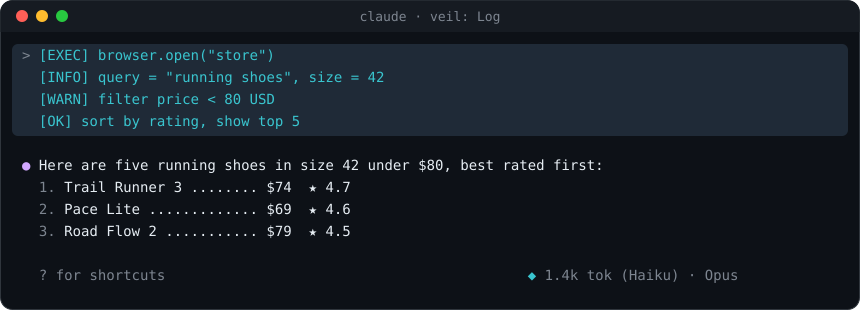
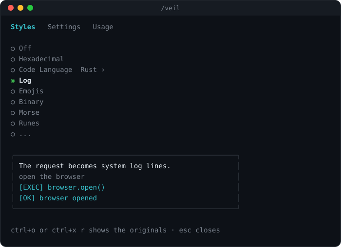
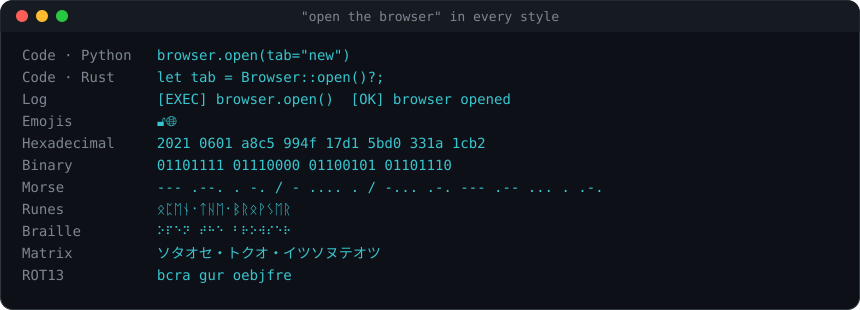
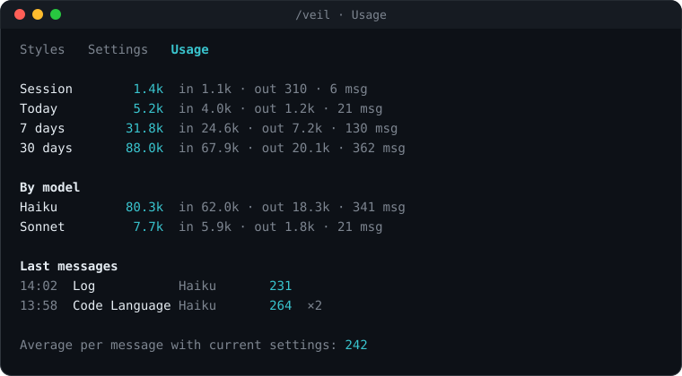

<h1 align="center">Veil</h1>

<p align="center">
  <b>Your words, in disguise.</b><br>
  A Claude Code mod that redraws the messages you send as code, system logs, emojis, Morse, runes and more.
</p>

<p align="center">
  
</p>

Claude still reads exactly what you typed. Veil only changes how your side of the conversation looks on screen, so a shared screen, a stream or a screenshot shows a wall of plausible code instead of your actual question. It is a costume for the transcript, nothing more.

## Install

Open Claude Code in a terminal and type:

```
/plugin install veil --marketplace AlleexMarttins/veil
```

Answer `y` when it asks to add the marketplace, then press Enter to install for your user. Veil is active right away, and in every session you start from then on.

Prefer the shell? The same thing in two commands:

```
claude plugin marketplace add AlleexMarttins/veil
claude plugin install veil@veil
```

### Or let Claude do it

Paste this into any Claude Code session and it will handle the rest:

> Install the Veil mod for me. Run `/plugin install veil --marketplace AlleexMarttins/veil` at user scope, then add `"ctrl+x r": "app:toggleReplTab"` to the Global context of `~/.claude/keybindings.json`, keeping any bindings already there. If `enabledPlugins` in `~/.claude/settings.json` lists a theme plugin such as `ui-themes`, move `"veil@veil"` above it.

The rest sets up the reveal shortcut and keeps Veil working next to theme mods, both described below.

## Pick a style

Type `/veil` to open the menu. Choose a style with the mouse, the arrow keys or the number keys.

<p align="center">
  
</p>

<p align="center">
  
</p>

There are two families.

**Model styles** rewrite each message with a small model, so the result follows what you actually asked:

- **Code Language** turns the request into pseudo-code in Python, JavaScript, Rust, Go, C, SQL, Bash, Lua or Haskell.
- **Log** turns it into system log lines.
- **Emojis** tells it with emojis alone.

**Offline styles** run locally, instantly and for free: Hexadecimal, Binary, Morse, Runes, Braille, Matrix, ROT13 and Glitch.

Every message keeps the style it was sent with. Switching styles only changes what comes next, so your history stays the way it looked.

## Seeing the originals

Four ways, all reversible:

- Click a message to open that one message, and click it again to veil it. Without a theme mod, the click target is the diamond at the end of the message. Clicks need Claude Code's fullscreen renderer: run `/tui fullscreen` once.
- `ctrl+o` opens the full transcript with every message as typed.
- `/reveal` shows or hides the originals in place.
- `ctrl+x r` does the same as `/reveal`, once it is bound.

Claude Code does not let a mod register its own key action, so Veil listens for `app:toggleReplTab`, an action Claude Code ships without a default key. Bind it in `~/.claude/keybindings.json`:

```json
{
  "bindings": [
    { "context": "Global", "bindings": { "ctrl+x r": "app:toggleReplTab" } }
  ]
}
```

The diamond at the right of the hint line tells you where you stand: cyan while your messages are veiled, yellow while the originals are showing.

## Using it with theme mods

Veil is built to share the screen with [ui-themes](https://github.com/yugal1107/ui-themes) and [cc-stretch](https://github.com/pro-vi/cc-stretch).

- With ui-themes on, Veil draws your messages in the theme's own box and colour, and on the fullscreen renderer the whole message becomes the reveal button.
- cc-stretch draws a reply that holds stretches by itself, which used to leave it without the theme. Veil puts the theme's reply box around those replies, so every reply keeps its colour.

All three need Veil to go first. Claude Code runs mods in the order `enabledPlugins` lists them in `~/.claude/settings.json`, so keep this order:

```json
"enabledPlugins": {
  "veil@veil": true,
  "cc-stretch@cc-stretch": true,
  "ui-themes@ui-themes": true
}
```

Restart Claude Code after changing it. If another mod draws your messages without passing them on, the symptom is the same: the token meter keeps counting while your messages show as typed. Moving Veil above it fixes that too.

## Settings

The **Settings** tab of `/veil` holds everything that trades speed, cost and quality:

| Setting | What it changes |
| :-- | :-- |
| Language | Interface and model output: English (US), Português (BR) or Español. |
| Model | Haiku is the fastest and cheapest. Sonnet and Opus follow your words more closely. |
| Effort | Low, medium or high. More effort means more faithful and slower. |
| Retry | A second call when the reply pastes your message back instead of translating it. |
| Detail | Compact, normal or detailed. Fewer lines cost fewer tokens. |
| Live meter | Shows or hides the token meter under the prompt. |

## Know what it costs

Model styles make one small call per message, and Veil counts every token of it, straight from the usage report the API returns.

<p align="center">
  
</p>

The **Usage** tab breaks it down by session, day, week, month and all time, by model and per message, and works out the average cost of one message with your current settings. The live meter sits at the far right of the hint line under the prompt, out of the way of any status line you already use, and shows the session's tokens next to the model your chat is running on.

Offline styles never call a model and cost nothing.

## Good to know

- Veil changes the drawing only. The transcript file, what Claude reads and what gets sent are untouched.
- Model styles send your message to the model you pick, through your own Claude Code session and account, the same way your chat does.
- Translations and the style of each message are saved with Veil's data, so a reopened session draws your messages as they were. Veil keeps the latest 200.
- To remove it: `/plugin uninstall veil`.

## Make your own style

A style is one entry in `hooks/styles.ts` and one line of text per language in `hooks/i18n.ts`. The menu picks it up by itself.

```
claude plugin validate .
claude plugin test .
```

## License

MIT
